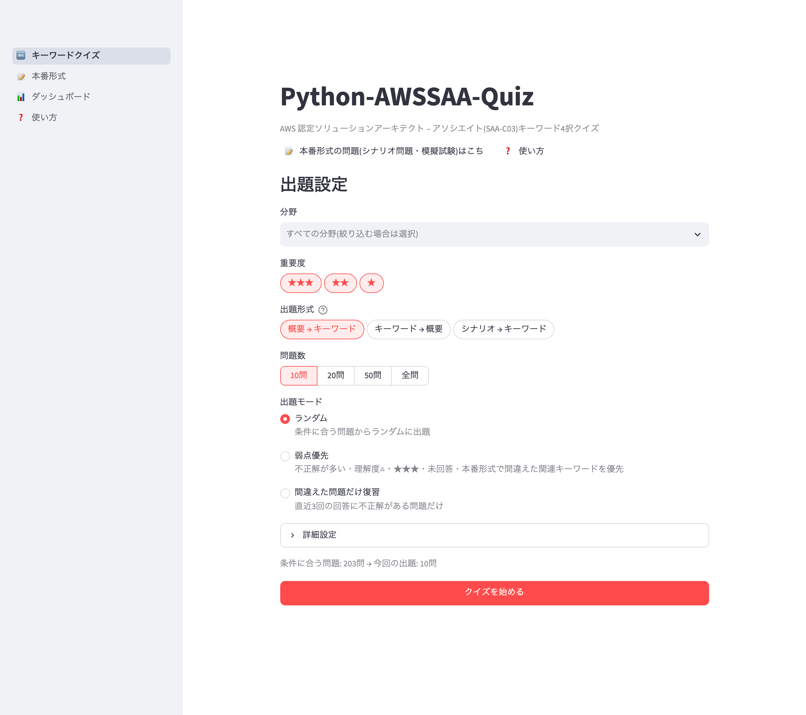
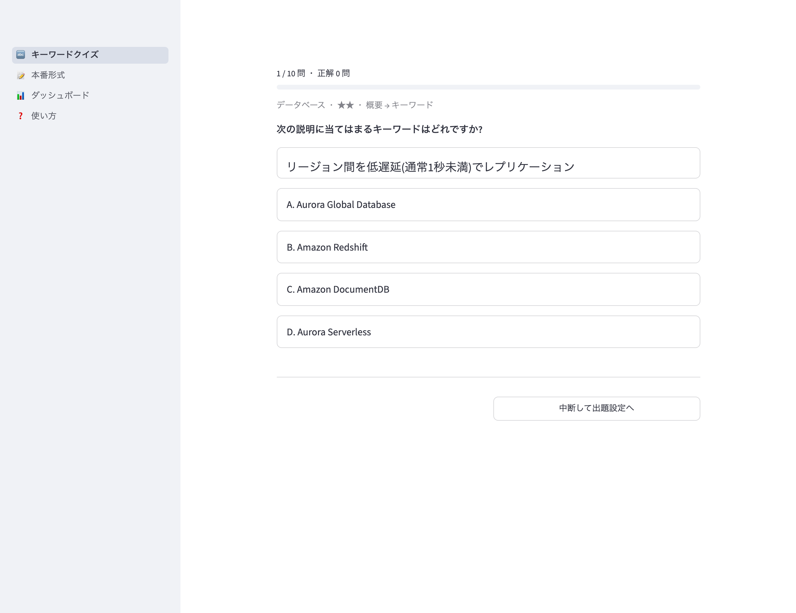
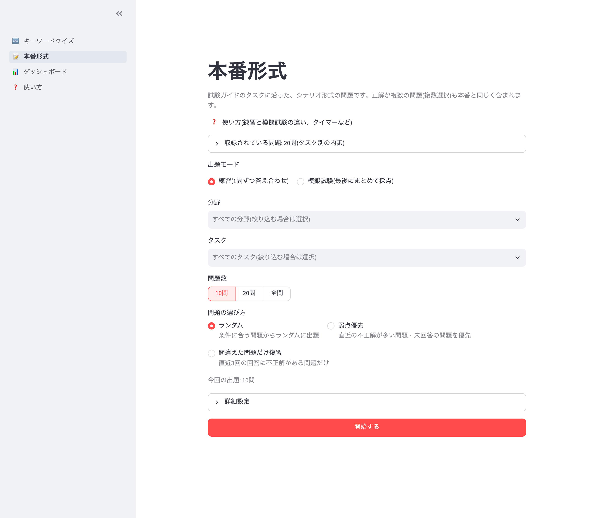
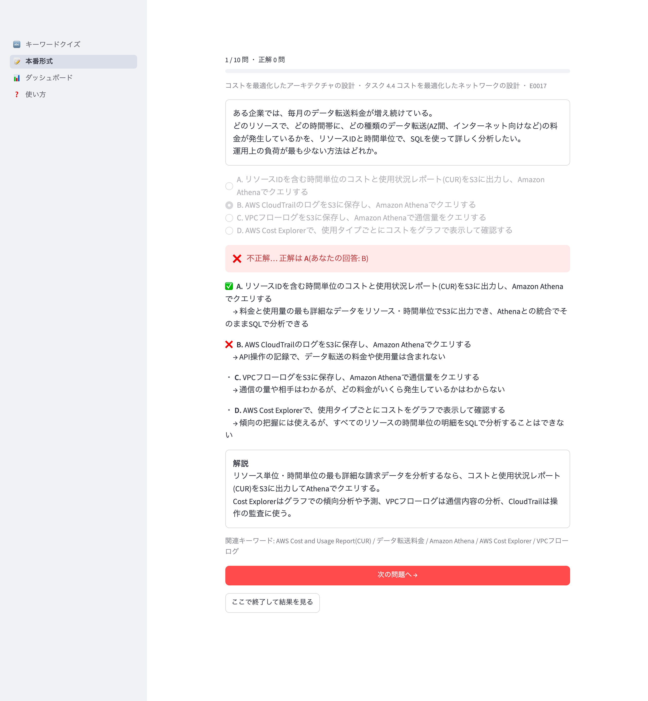
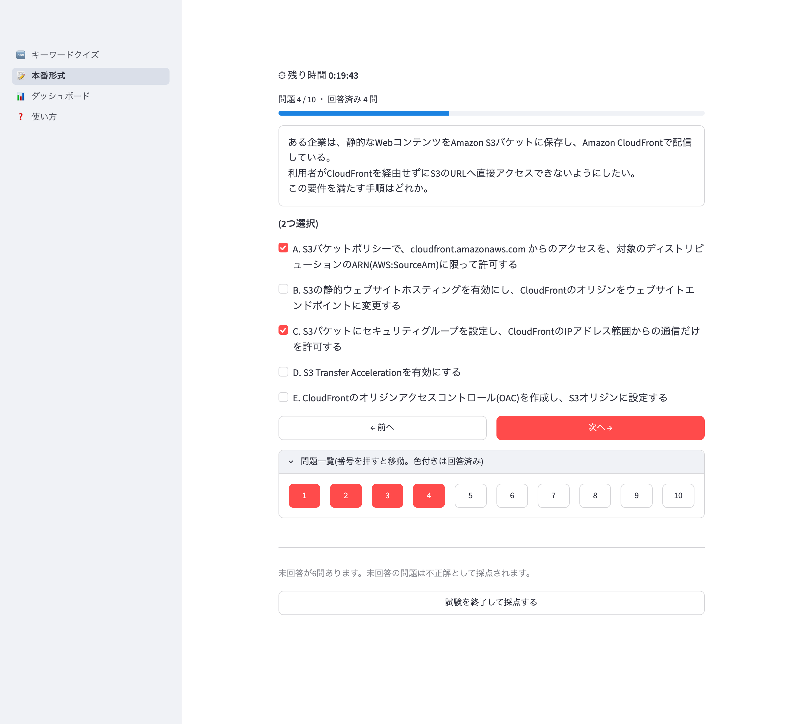
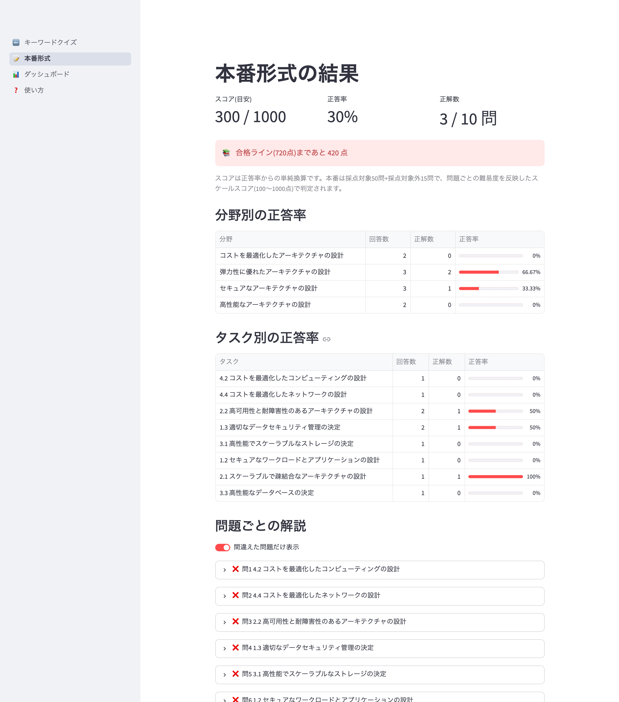
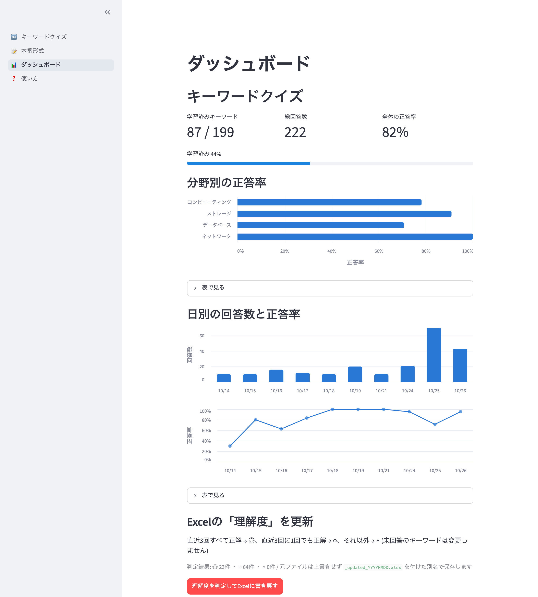
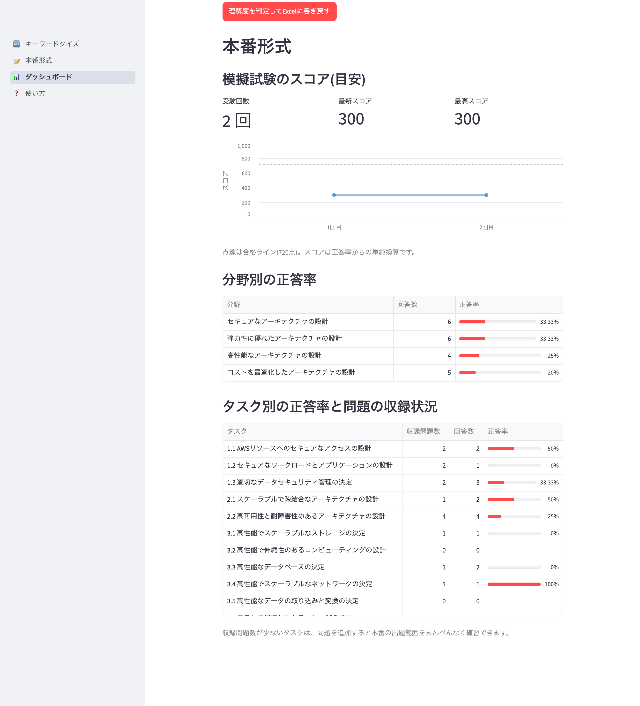

# Python-AWSSAA-Quiz

AWS 認定ソリューションアーキテクト – アソシエイト(SAA-C03)の学習用クイズアプリです(Streamlit製・ローカル実行用)。

- **キーワードクイズ**:キーワード集(Excel)から4択問題を自動で作り、サービスや用語を覚える
- **本番形式**:試験ガイドに沿ったシナリオ問題を、練習モードか模擬試験で解く
- **ダッシュボード**:学習状況を集計し、理解度をExcelに書き戻す

## 目次

- [スクリーンショット](#スクリーンショット)
- [セットアップと起動](#セットアップと起動)
- [使い方](#使い方)
  - [おすすめの学習の流れ](#おすすめの学習の流れ)
  - [キーワードクイズ](#キーワードクイズ)
  - [本番形式](#本番形式)
  - [ダッシュボード](#ダッシュボード)
- [問題を増やす・更新する](#問題を増やす更新する)
  - [本番形式の問題を増やす](#本番形式の問題を増やす)
  - [キーワード集(Excel)を更新する](#キーワード集excelを更新する)
- [開発者向け](#開発者向け)

## スクリーンショット

### キーワードクイズ

| 出題設定 | クイズ |
|---|---|
|  |  |

### 本番形式

| 出題設定 | 練習モード(答え合わせ) |
|---|---|
|  |  |

| 模擬試験(タイマー・問題一覧) | 模擬試験の結果 |
|---|---|
|  |  |

### ダッシュボード

| キーワードクイズ | 本番形式 |
|---|---|
|  |  |

## セットアップと起動

### 必要なもの

- macOS / Linux / Windows
- [uv](https://docs.astral.sh/uv/)(Python 3.12 は uv が自動で用意します)

### セットアップ

```bash
git clone https://github.com/shim369/Python-AWSSAA-Quiz.git
cd Python-AWSSAA-Quiz
uv sync
```

キーワード集(`data/AWS_SAA_重要キーワード集.xlsx`)と本番形式のサンプル問題(`data/exam_questions/`)は同梱済みです。
`git pull` で更新したあとも `uv sync` を実行してください(`exam-questions` コマンドなどが入ります)。

### 起動

```bash
uv run streamlit run app.py
```

ブラウザで http://localhost:8501 が開きます。左のサイドバーから各画面に移動できます。

### デスクトップのアイコンから起動する(macOS)

```bash
./launcher/build.sh
```

デスクトップに `AWS SAA Quiz.app` ができます。ダブルクリックするとターミナルを出さずに起動し、ブラウザが開きます。
起動中にもう一度ダブルクリックすると「ブラウザで開く」「アプリを終了」を選べます(ログは `~/Library/Logs/AWSSAAQuiz.log`)。
アプリにはリポジトリの場所が埋め込まれるため、リポジトリを移動したら `build.sh` を実行し直してください。

## 使い方

| 画面 | できること |
|---|---|
| キーワードクイズ(起動時の画面) | キーワードの4択クイズの出題設定・出題・結果(この画面の中で切り替わる)。回答後に正誤と、そのキーワードの「概要」「頻出ポイント」を表示。結果では分野別の正答率と間違えた問題の一覧を表示し、間違えた問題だけをすぐ解き直せる |
| 本番形式 | シナリオ問題の出題設定・出題・結果(この画面の中で切り替わる) |
| ダッシュボード | 両方の学習状況の集計、Excelへの理解度の書き戻し |
| 使い方 | この README の「使い方」の内容をアプリ内で確認できる |

### おすすめの学習の流れ

1. **キーワードクイズ**でサービスや用語を覚える(まずは「概要 → キーワード」から)
2. **本番形式の練習**で、分野やタスクごとにシナリオ問題を解き、選択肢ごとの理由を読む
3. 本番形式で間違えた問題の関連キーワードは、キーワードクイズの「弱点優先」で出やすくなるので、そこで復習する
4. ある程度解けるようになったら**模擬試験**を受け、ダッシュボードでスコアの推移と苦手なタスクを確認する

### キーワードクイズ

「キーワードクイズ」の画面で条件を選び、「クイズを始める」を押します。

| 設定 | 内容 |
|---|---|
| 分野 | 絞り込む分野(未選択ならすべて) |
| 重要度 | ★★★ / ★★ / ★ |
| 出題形式 | 下の3つから選ぶ。複数選ぶと、問題ごとにランダムで形式が決まる |
| 問題数 | 10問 / 20問 / 50問 / 全問 |
| 出題モード | ランダム / 弱点優先 / 間違えた問題だけ復習 |
| 詳細設定 | 乱数シード(同じシードなら同じ問題が出る) |

出題形式:

1. **概要 → キーワード**:概要文から正しいキーワードを選ぶ(概要の中のキーワード名は「〇〇」で伏せる)
2. **キーワード → 概要**:キーワードから正しい概要を選ぶ
3. **シナリオ → キーワード**:「試験での頻出ポイント」から最適なサービス・機能を選ぶ

出題モード:

- **ランダム**:条件に合う問題からランダムに出題
- **弱点優先**:次の重みで抽選(重いほど出やすい)
  `1 + 3×直近3回の不正解数 + 2×(理解度が△) + 1×(★★★) + 1×(未回答) + 2×(本番形式で関連問題を間違えた)`
  理解度△は、Excelの「理解度」列か、回答履歴からの判定のどちらかが△なら該当します
- **間違えた問題だけ復習**:直近3回の回答に不正解がある問題だけを出題

途中で別の画面に移っても、「キーワードクイズ」に戻れば続きから再開できます。「ここで終了して結果を見る」で途中までの結果を確認でき、「中断して出題設定へ」で出題設定に戻れます。

### 本番形式

本番の SAA-C03 と同じ形式のシナリオ問題です。正解1つの4択と、5択から2つ選ぶ複数選択があります
(複数選択の問題には「(2つ選択)」と表示され、チェックボックスで答えます)。
問題は [試験ガイド](https://docs.aws.amazon.com/aws-certification/latest/solutions-architect-associate-03/solutions-architect-associate-03.html)
の4分野・14タスクに分類しています。選択肢の並びは出題のたびにシャッフルされます。

設定画面の「収録されている問題」を開くと、タスクごとの問題数と回答済みの数を確認できます。

#### 練習モード(1問ずつ答え合わせ)

1. 分野・タスクで絞り込み(未選択ならすべて)、問題数(10問 / 20問 / 全問)と問題の選び方を選んで「開始する」
   - 問題の選び方:**ランダム** / **弱点優先**(直近の不正解が多い・未回答の問題を優先)/ **間違えた問題だけ**
2. 選択肢を選んで「回答する」(複数選択の問題は、指定の数だけ選ぶと押せるようになる)
3. 正誤のあと、選択肢ごとの正解・不正解の理由、解説、関連キーワードが表示される
4. 「次の問題へ」で進む。途中で「ここで終了して結果を見る」も押せる

#### 模擬試験(最後にまとめて採点)

1. 問題数(65問=本番と同じ / 30問 / 10問)とタイマーのON/OFFを選んで「開始する」
   - 全分野から試験ガイドの出題比率(30% / 26% / 24% / 20%)に沿って選び、分野を混ぜて出題する
   - 収録されている問題が足りないときは、ある分だけ出題する
2. 回答しても答え合わせは出ない。「← 前へ」「次へ →」や「問題一覧」の番号で自由に移動し、回答を変えられる
3. 「試験を終了して採点する」で採点。未回答の問題は不正解として扱う

タイマー:

- **ON**:1問あたり2分(65問で130分)。残り時間が表示され、5分を切ると目立つ表示になり、時間切れで自動的に採点する
- **OFF**:時間制限なし。経過時間だけを表示する

#### 結果画面

- 模擬試験はスコア(1000点満点の目安)と合格ライン(720点)との比較、練習は正答率と正解数
- 分野別・タスク別の正答率
- 問題ごとの解説(「間違えた問題だけ表示」で絞り込める)
- 「間違えた問題を練習で解き直す」で、間違えた問題だけの練習をすぐ始められる

スコアは正答率を1000点に換算した目安です。本番は採点対象50問+採点対象外15問で、
難易度を反映したスケールスコア(100〜1000点)で判定されます。

### ダッシュボード

**キーワードクイズ**

- 学習済みキーワード数、総回答数、全体の正答率
- 分野別の正答率、日別の回答数と正答率

**本番形式**

- 模擬試験のスコア推移(合格ラインつき)、受験回数、最新・最高スコア
- 分野別の正答率
- タスク別の正答率と収録問題数(収録の少ないタスクは、問題を増やす目安になる)

**Excelへの書き戻し**

「理解度を判定してExcelに書き戻す」ボタンで、キーワードクイズの回答履歴から理解度を判定し、
「理解度」列(G列)に書き込みます。

- 判定基準:直近3回すべて正解なら **◎ 説明できる**、直近3回に1回でも正解があれば **○ なんとなく**、それ以外は **△ 要復習**
- まだ回答していないキーワードのセルは変更しません
- 元のファイルは上書きせず、`data/AWS_SAA_重要キーワード集_updated_YYYYMMDD.xlsx` に保存します
  (同じ日に何度も実行した場合は、その日のファイルを上書きします)
- 保存したファイルは画面のボタンからダウンロードもできます

## 問題を増やす・更新する

### 本番形式の問題を増やす

問題は `data/exam_questions/*.yaml` に保存されています。増やし方は3通りあります。

| 方法 | 向いている場面 | 費用 |
|---|---|---|
| [Claude Code の skill](#claude-code-で作るおすすめ)(おすすめ) | 対話しながら少しずつ増やす。AWS公式ドキュメントでの事実確認つき | Claude Code の利用枠 |
| [YAMLを手で書く](#yamlを手で書く) | 自分で作った問題を足す | なし |
| [Claude API のスクリプト](#claude-api-で下書きを作る) | まとめて大量に作る・自動化する | Claude API の従量課金 |

どの方法でも、[作問ルール](docs/exam_question_guidelines.md)は共通です。
目安として、65問あれば模擬試験を1回分組め、150〜200問(1タスク10〜15問)あれば繰り返し受けても同じ問題ばかりになりません。

#### Claude Code で作る(おすすめ)

このリポジトリには Claude Code 用の skill(`.claude/skills/exam-questions/`)が入っています。
リポジトリのフォルダで Claude Code を起動し、次のように頼みます。

- 「本番形式の問題を増やして」(収録の少ないタスクを2つ選んで5問)
- 「タスク3.5の問題を4問作って。Kinesisとデータレイクを中心に」
- `/exam-questions` で直接呼び出すこともできます

Claude は次の順に進めます。

1. 収録状況を調べ、作問ルール・タスクの観点・同じタスクの既存の問題・キーワード集を読む
2. `data/exam_questions/drafts/` に下書きを書く(ここは出題されない)
3. 正解と各誤答の理由を、AWS公式ドキュメントで確かめる(確認した資料のURLはYAMLのコメントに残る)
4. `exam-questions check` でエラーがなくなるまで直す
5. 問題ごとの要点を見せて、レビューを依頼する

内容を確認し、追加してよい問題・直してほしい問題・不要な問題を伝えてください。
了承した問題だけが `data/exam_questions/` に移され、テストまで実行されます。
skillが候補に出ないときは、Claude Code を起動し直してください。

#### YAMLを手で書く

`data/exam_questions/` のYAMLファイル(どのファイルに書いてもよい。分野ごとに分けてある)に、次の形式で追加します。
保存すれば、アプリを開いたままでもページの再読み込みで反映されます。

```yaml
- id: E0015                # 「E」+4桁。uv run exam-questions next-id で次の番号がわかる
  domain: resilient        # secure / resilient / performant / cost
  task: "2.2"              # 試験ガイドのタスク(domain に属するもの。一覧は exam_guide.py)
  question: |
    問題文(複数行可)。「2つ選択」は画面に自動で出るので書かない
  choices:                 # 正解1つなら4つ。正解が複数なら5つ以上で、誤答を3つ以上
    - text: 選択肢の文
      correct: true        # 正解の選択肢だけに書く
      reason: 正解の理由
    - text: 選択肢の文
      reason: 不正解の理由(どの要件を満たさないか)
    # …
  explanation: |
    この問題で覚えるべきポイント
  related_keywords: [40, 41]   # キーワード集のNo(本番形式で間違えると、キーワードクイズで出やすくなる)
```

- 追加後は `uv run exam-questions check` で確認します
- 回答履歴は id で記録されます。内容を直すとき、同じ問題として履歴を残したいならidを変えずに、別の問題にするなら新しいidにします

#### Claude API で下書きを作る

試験ガイドのタスクとキーワード集をもとに、問題の下書きを生成するスクリプトです。
事実確認はしないので、レビューは必ず人が行ってください。

```bash
export ANTHROPIC_API_KEY=...   # Claude API のキー
uv run --group tools python scripts/draft_exam_questions.py                       # 収録の少ないタスクから5問
uv run --group tools python scripts/draft_exam_questions.py --task 3.4 --count 6  # タスクを指定(複数可、1回10問まで)
uv run --group tools python scripts/draft_exam_questions.py --task 2.2 --note "DR戦略の比較を中心に"
```

- 下書きは `data/exam_questions/drafts/draft_YYYYMMDD_HHMMSS.yaml` に保存され、**そのままでは出題されません**(git管理外)
- 正解や理由がAWSの現在の仕様と合っているかを確認・修正してから、`data/exam_questions/` のYAMLに移し、下書きからは消してください
- アプリと同じ検証にかけ、形式に誤りがある問題は除外します。idは既存の問題・下書きの続きの番号を振ります
- 既定のモデルは `claude-opus-5-5` です(`--model` で変更可)。生成を断られた場合は、ほかのモデルで自動的に再試行します

#### 確認コマンド(exam-questions)

```bash
uv run exam-questions check                    # 出題中の問題と下書きをすべて確認
uv run exam-questions check data/exam_questions/drafts/draft_xxx.yaml   # 指定したファイルだけ
uv run exam-questions coverage                 # タスク別の収録数(どこが足りないか)
uv run exam-questions next-id 5                # 次に使えるidを5個
```

`check` は、形式の誤り、idの重複(出題中の問題と下書きをまたいで確認)、キーワード集にないNo、問題文の「〇つ選択」を「エラー」、
作問ルール上の見直し候補(正解の選択肢だけが長い、解説がない、など)を「注意」として表示します。

#### 過去問・出題傾向について

AWS認定の試験問題は受験時の秘密保持契約(NDA)の対象で、公開されていません。
「過去問」として出回っている問題集(いわゆるブレインダンプ)を使うことは認定プログラムの規約違反になり、
認定の取り消し対象にもなるため、このアプリには入れないでください。
本番に近い練習には、次の公式教材と組み合わせるのがおすすめです。

- 試験ガイドのタスクと「Knowledge of / Skills in」(このアプリの問題分類のもと)
- AWS公式のサンプル問題、AWS Skill Builder の公式練習問題集(Official Practice Question Set)・公式模擬試験

試験ガイドが改訂されたら、`src/python_awssaa_quiz/exam_guide.py` のタスク一覧を更新してください。

### キーワード集(Excel)を更新する

1. `data/AWS_SAA_重要キーワード集.xlsx` を新しいファイルで置き換えます
   (書き戻した理解度を出題に反映したい場合は、`_updated_YYYYMMDD.xlsx` をこの名前にリネームして置き換えます)
2. アプリを開いたままでも、ページを再読み込みすれば反映されます(ファイルの更新日時が変わると自動で読み直します)
3. 列の構成は変えないでください:シート「キーワード一覧」の4行目が見出し、5行目からデータ、
   A=No / B=分野 / C=キーワード / D=概要 / E=試験での頻出ポイント / F=重要度 / G=理解度
4. 回答履歴と本番形式の `related_keywords` は **No** で紐づいています。既存のキーワードの No を振り直すと、
   過去の履歴や関連づけが別のキーワードのものとして扱われます。新しいキーワードは末尾に新しい No で追加してください
5. 追加後に `uv run pytest` を実行し、問題文に答えが出ていないか確認してください。
   件数が208件から変わった場合は、`tests/test_loader.py` などの件数・行番号のテストも合わせて直してください

## 開発者向け

### テスト

```bash
uv run pytest
```

主な確認内容:

- キーワードクイズの問題文(「キーワード→概要」形式では正解の選択肢)に、正解のキーワード名や略称・別名が含まれていない
- 選択肢が4つで重複がなく、正解がちょうど1つ含まれている。同じシードなら同じ問題が再現される
- Excelへの書き戻し後も、他の列・書式・入力規則・「分野別集計」シートの数式が残っている
- 画面を再実行しても問題・選択肢が変わらず、回答が二重に記録されない(`tests/test_app.py`)
- 本番形式の問題データが `exam-questions check` と同じ確認を通る(`tests/test_exam_bank.py`)
- 模擬試験が分野の出題比率どおりに選ばれ、タイマーOFFでも動き、時間切れで自動的に採点される
- 問題の下書き生成の検証と保存(APIは呼ばずに確認。`tests/test_exam_drafting.py`)

### キーワードクイズの問題生成の調整箇所(`src/python_awssaa_quiz/quiz_engine.py`)

| 定数 | 用途 |
|---|---|
| `EXTRA_ALIASES` | 正式名称・旧名など、名前から機械的に導けない別名(問題文で「〇〇」に伏せる) |
| `RELATED_PAIRS` | 同時に選択肢に並ぶと正解が曖昧になる組み合わせ(例:ELB と ALB) |
| `SCENARIO_EXCLUDED_NOS` | 頻出ポイントが一般的すぎて、シナリオ問題にしないキーワードの No |

このほか、次の処理は自動で行います。

- 「Amazon」「AWS」を省いた表記と、括弧内の英字の略称(RI、DLQ など)を伏せる
- 名前の前方一致で親子関係にあるもの(例:Amazon S3 と S3ライフサイクルポリシー)は、お互いを誤答にしない
- 「Amazon Comprehend / Textract / …」のように、キーワードと概要が「 / 」で同じ数に分かれる行は、
  サービスごとの問題に分割する(履歴はサービスごとに記録し、Excelへの書き戻しでは元の行にまとめて判定する)

### 回答履歴

- 保存先は `data/history.db`(SQLite、自動作成・git管理外)。キーワードクイズは `answers`、本番形式は `exam_answers` テーブルに分けて保存します
- 保存先は環境変数 `AWSSAA_QUIZ_DB` で変更できます(例:`AWSSAA_QUIZ_DB=/tmp/test.db uv run streamlit run app.py`)

### ディレクトリ構成

```
Python-AWSSAA-Quiz/
├── app.py                  # 起動用(画面の一覧とサイドバーの並び。st.navigation)
├── pages/
│   ├── keyword_quiz.py     # キーワードクイズの出題設定・出題・結果
│   ├── exam.py             # 本番形式の出題設定・出題・結果
│   ├── dashboard.py        # ダッシュボード
│   └── how_to_use.py       # アプリ内の使い方(README の「使い方」と内容をそろえる)
├── src/python_awssaa_quiz/
│   ├── loader.py           # Excelの読み込みとデータクラスへの変換
│   ├── quiz_engine.py      # キーワードクイズの問題生成・出題順の決定(Streamlitに依存しない)
│   ├── storage.py          # SQLiteへの回答履歴の保存と集計
│   ├── excel_writer.py     # 理解度の判定とExcelへの書き戻し
│   ├── exam_guide.py       # 試験ガイドの分野・タスク
│   ├── exam_bank.py        # 本番形式の問題の読み込み・検証・出題(Streamlitに依存しない)
│   ├── exam_drafting.py    # Claude API での問題の下書き生成
│   ├── exam_cli.py         # exam-questions コマンド(問題データの確認)
│   └── ui.py               # 画面共通の処理(Streamlitに依存するのはここだけ)
├── data/
│   ├── AWS_SAA_重要キーワード集.xlsx
│   ├── exam_questions/     # 本番形式の問題(YAML)。drafts/ は下書き(出題されない・git管理外)
│   └── history.db          # 回答履歴(自動作成・git管理外)
├── docs/
│   └── exam_question_guidelines.md  # 本番形式の作問ルール(skill とスクリプトで共通)
├── scripts/
│   └── draft_exam_questions.py  # Claude API で本番形式の問題の下書きを作る
├── .claude/skills/exam-questions/  # Claude Code で本番形式の問題を作る skill
├── launcher/               # macOS 用ランチャー
└── tests/
```
